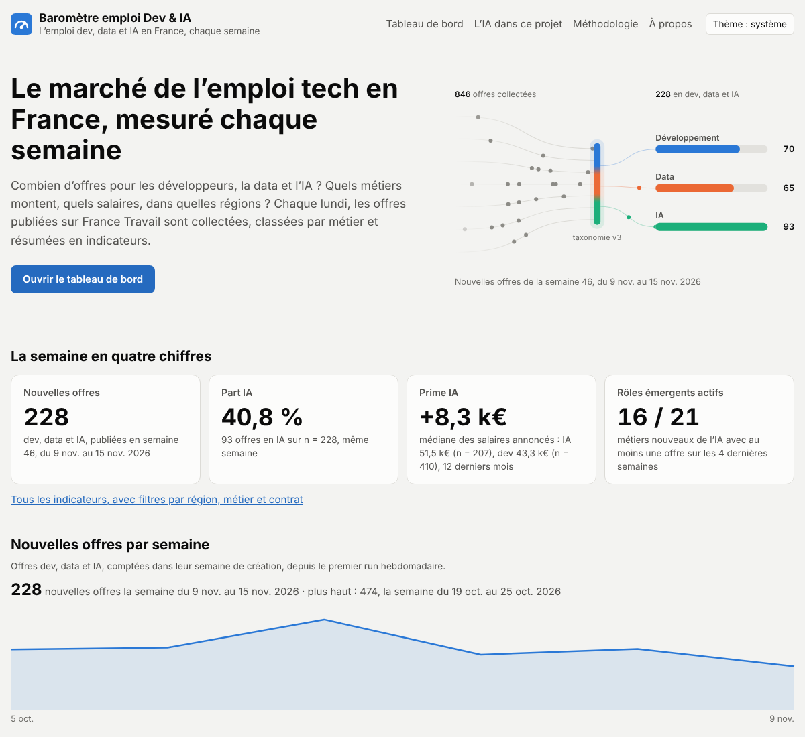

# Baromètre emploi Dev & IA

Le marché de l'emploi dev, data et IA en France, mesuré chaque semaine à partir des offres
publiées sur France Travail : volumes, métiers, salaires, régions.

**Site : [barometre.dg-tech.dev](https://barometre.dg-tech.dev)**



Ce dépôt contient tout le baromètre : la collecte, le classement des offres par métier, le
calcul des statistiques et le site public. C'est aussi une démonstration de développement
avec l'IA : la spécification et le code ont été écrits par Claude, lot par lot, et chaque
changement a été relu et fusionné par [Damien Gros](https://dg-tech.dev).

## En bref

- **Collecte** : chaque lundi matin, un serveur interroge l'API « Offres d'emploi » de France
  Travail et récupère tout le stock d'offres ouvertes des métiers de l'informatique, plus une
  recherche par mots-clés pour les métiers de l'IA.
- **Classement** : chaque offre est rangée dans l'un des 51 métiers de
  [`taxonomy.yaml`](taxonomy.yaml) par des règles explicites appliquées à son intitulé, sans
  IA. Le même intitulé donne toujours le même métier.
- **Statistiques** : nouvelles offres par semaine, part de l'IA, salaires, technologies,
  carte. Une valeur calculée sur moins de 5 offres est masquée.
- **Publication** : seuls des agrégats sont envoyés au site, sans redéploiement. Aucune
  annonce n'est republiée et aucune donnée collectée n'est versionnée.
- **Technique** : TypeScript, Node 22, Vitest (plus de 500 tests) ; site statique Vite avec
  ECharts et Leaflet sur Netlify ; jobs planifiés par systemd sur un VPS, alertes ntfy,
  sauvegarde chiffrée vers Cloudflare R2. Pas de base de données.

## L'IA dans ce projet

- [`SPEC.md`](SPEC.md) et [`taxonomy.yaml`](taxonomy.yaml) ont été rédigés par Claude au fil
  de discussions avec Damien, qui les a validés avant le premier commit, le 2 octobre 2026.
- Tout le code a ensuite été écrit par Claude Code, en suivant [`CLAUDE.md`](CLAUDE.md) : un
  lot par pull request, tests verts, points « [À VÉRIFIER] » confirmés sur l'API réelle avant
  d'être codés, et chaque latitude consignée dans [`docs/decisions.md`](docs/decisions.md).
- L'exploitation suit la même règle : Claude Code prépare et vérifie, Damien fait les gestes
  sensibles (secrets, droits d'administration).
- Le classement des offres et les chiffres restent sans IA, pour être reproductibles,
  explicables et testables.

Le récit complet, avec les décisions et les incidents réels, est sur la page
[L'IA dans ce projet](https://barometre.dg-tech.dev/ia/) ; la méthode des chiffres, sur la
page [Méthodologie](https://barometre.dg-tech.dev/methodologie/).

## État

En production depuis le 7 octobre 2026, avec un run automatique chaque lundi. Livrés : lots 0
à 2, 4 et 5 (socle, collecte France Travail, traitement, tableau de bord, VPS et alertes) et
le site public, lots S1 à S4. À venir : la revue mensuelle de la taxonomie par Claude (lot 6),
le résumé de la semaine (S5) et des analyses (S6). La source Adzuna (lot 3) attend une décision
(D50). Les lots sont décrits au §14 de la spec.

## Démarrage

Prérequis : Node 22 (voir `.nvmrc`).

```sh
npm ci
npm run check      # lint + typecheck + tests
npm test           # tests seuls (Vitest)
npm run build      # site statique dans web/dist
```

Les variables d'environnement sont documentées dans [`.env.example`](.env.example). Aucune
donnée ni aucun secret n'est versionné.

## Collecte France Travail

```sh
npm run collect:ft -- --mode fixtures   # sans clé : offres fictives de fixtures/
npm run probe:ft                         # vérifie les points [À VÉRIFIER] sur l'API réelle
npm run collect:ft -- --run-id 2026-W41  # collecte réelle nationale, stockée dans .data/
```

Le mode réel lit `FT_CLIENT_ID` et `FT_CLIENT_SECRET` dans l'environnement ou dans `.env`.
Une collecte interrompue reprend où elle s'est arrêtée ; `--reset` repart de zéro.

En production, la collecte tourne sur le VPS dans le job `weekly-run` (voir plus bas).

## Traitement et agrégats

```sh
npm run collect:ft -- --mode fixtures --run-id 2026-W41   # collecte d'abord
npm run process -- --run-id 2026-W41                      # puis traitement, dans .data/
```

Le traitement relit `raw` du run, normalise et classe les offres (schéma `Offer`, SPEC.md
§6.1), applique la règle de rétention de la passe B, met à jour l'index `seen` (nouveautés,
disparitions, premier run) et écrit `offers/<run>.jsonl.gz`, puis recalcule tous les agrégats
(`aggregates/*.json`, SPEC.md §7) à partir de `offers/*`. Il est rejouable : une relance du
même run donne le même résultat. Il refuse un run dont la collecte est en cours, ou plus
ancien que le dernier run traité.

## Site, dashboard et envoi des agrégats

```sh
npm run process -- --run-id 2026-W41   # agrégats dans .data/aggregates
npm run dev:web                         # site sur http://localhost:5173, lit .data/aggregates
npm run build && npm run preview:web    # version de production, mêmes données locales
npm run push                            # envoi au site : SITE_URL et INGEST_SECRET requis
npm run site:images                     # images de partage et icône (Playwright, ponctuel)
```

Le site public (SPEC.md §17) est un site statique Vite à plusieurs pages : accueil, tableau de
bord sous `/tableau-de-bord/`, « L'IA dans ce projet » (`/ia/`), Méthodologie, À propos,
mentions légales, page 404. Pages, titres et descriptions sont déclarés dans
`web/site/config.ts` ; le gabarit commun (`web/site/template.ts`) injecte au build l'en-tête, la
navigation, le pied de page et les textes Markdown de `web/content/`, avec sous leur titre la
mention de leur rédaction avec Claude (SPEC.md §17.1). Les anciens liens `/#/<page>` du
dashboard mènent à `/tableau-de-bord/#/<page>`. Le site reste en `noindex` jusqu'au lancement ;
`SITE_INDEXABLE=1` au build (variable Netlify) ouvre l'indexation et publie `sitemap.xml`, à
côté de `robots.txt`, écrit à chaque build. Décisions D45 à D64.

Le dashboard (ECharts, Leaflet) lit les agrégats par `GET /api/data/:name`. `npm run push` envoie chaque fichier de `.data/aggregates` (ou
`DATA_DIR`) à `PUT /api/ingest/:name`, `meta.json` en dernier : le site passe au nouveau run
sans déploiement. Pages, filtres et règles d'affichage : SPEC.md §8, décisions D31 à D36.

## VPS : jobs planifiés, alertes, sauvegarde

Sur le VPS (D21), des timers systemd de l'utilisateur `veille` lancent chaque lundi le job
`weekly-run` (collecte, traitement, envoi ; relances à 06:00 et 07:00 UTC) puis la sauvegarde
de `DATA_DIR` vers Cloudflare R2 (restic). Les alertes partent sur ntfy, depuis le VPS et depuis
la fonction planifiée `watchdog` du site (aucun run réussi depuis 8 jours). Installation et
commandes du quotidien : [deploy/vps/README.md](deploy/vps/README.md) ; décisions D37 à D42.

```sh
npm run weekly-run -- --run-id 2026-W41   # en local : même job, dans .data/ (ou DATA_DIR)
npm run admin -- status --run-id 2026-W41 # état d'un run ; autres commandes en tête de scripts/admin.ts
deploy/vps/veille-job admin status        # sur le VPS : environnement et verrou en plus
```

## Organisation

```
taxonomy.yaml           taxonomie des métiers (source de vérité, conventions en tête)
TAXONOMY_CHANGELOG.md   journal des versions de la taxonomie
netlify.toml            site Netlify : site public, en-têtes de sécurité, API des agrégats, watchdog
src/core/               normalize, taxonomy, classify, signals, salary, location, employer, dedup, stats
src/refs/               départements (101), régions (18), population active INSEE par région
src/sources/            interface Source, client HTTP bridé, collecteur France Travail (Adzuna au lot 3)
src/pipeline/           état des runs, traitement, agrégats (aggregates/), envoi, weekly-run, alertes, sauvegarde
src/storage/            stores Netlify Blobs, mémoire (tests) et disque (VPS, scripts)
src/functions/          logique des fonctions Netlify, testable
netlify/functions/      fonctions Netlify : api-ingest, api-data, watchdog
scripts/                jobs du VPS (weekly-run, admin, backup), collecte, traitement, envoi, sonde FT, images du site
deploy/vps/             lanceur veille-job, unités systemd, procédure d'installation du VPS
web/                    site Vite : pages HTML d'entrée, dashboard (web/src/pages), calculs testés (web/src/lib)
web/site/               pages du site et gabarit commun, appliqué au build
web/content/            textes des pages en Markdown
fixtures/               réponses d'API fictives, mode SOURCE_MODE=fixtures
tests/                  tests Vitest ; tests/fixtures/titles.json = cas de classification
docs/decisions.md       décisions d'implémentation
docs/images/            capture de l'accueil pour ce README
```

## Utiliser le cœur

```ts
import { classify } from './src/core/classify';
import { normalize } from './src/core/normalize';
import { parseTjm } from './src/core/salary';
import { detectSignals, detectTechs } from './src/core/signals';
import { loadCompiledTaxonomy } from './src/core/taxonomy';

const taxonomy = await loadCompiledTaxonomy(); // une fois par exécution
const titleNorm = normalize('Ingénieur IA (H/F)');
const descriptionNorm = normalize('Vous concevrez des solutions basées sur des LLM et du RAG.');

classify(titleNorm, descriptionNorm, taxonomy);
// { role: 'ai_engineer', group: 'g4_genai_agentique', secondaryRoles: [], requalified: true }
const signals = detectSignals(titleNorm, descriptionNorm, taxonomy); // aiAny, genai, tjm, travel, remote
const techs = detectTechs(titleNorm, descriptionNorm, taxonomy); // ['llm', 'rag']
const tjm = signals.tjm ? parseTjm(`${titleNorm} ${descriptionNorm}`) : null;
```

## Faire évoluer la taxonomie

Toute modification de `taxonomy.yaml` (revue mensuelle ou correction) doit :

1. respecter les conventions en tête du fichier : motifs écrits pour le texte normalisé, jamais
   de suppression ni de renommage d'`id` (passer `status: deprecated`) ;
2. incrémenter `version` et mettre `updated` à la date du jour ;
3. ajouter l'entrée `## v<N> — <AAAA-MM-JJ>` dans `TAXONOMY_CHANGELOG.md`, avec la
   justification chiffrée de chaque changement ;
4. ajouter dans `tests/fixtures/titles.json` au moins un cas par motif ajouté ou modifié :
   `{ "source": "...", "title": "...", "description"?: "...", "role": "...", "group": "...", "requalified"?: true }`
   (`role` et `group` valent `non_classe` pour un intitulé hors taxonomie) ;
5. passer `npm test`, qui vérifie le schéma, la cohérence et tous les cas de classification.

## Licence

Code sous licence MIT ([LICENSE](LICENSE)). Le dépôt ne contient aucune donnée collectée ; les
statistiques publiées viennent des offres France Travail (SPEC.md §11, D20).
